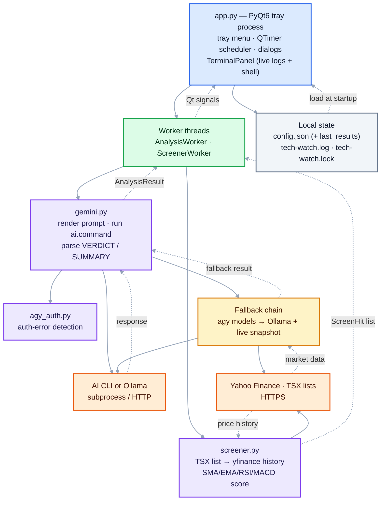

# Architecture

Tech Watch is a single PyQt6 tray application. One GUI process owns the
scheduler, the worker threads and all local state; everything external is
reached through subprocesses or HTTP.

Solid arrows are requests; dashed arrows are responses.

- **app.py — PyQt6 tray process**: all UI (tray icon/menu, dialogs, TerminalPanel) plus scheduling and result display.
- **Worker threads**: run AI checks and screener scans off the GUI thread; they have no UI and report back via Qt signals.
- **gemini.py**: builds the prompt, runs the configured AI command, and parses `VERDICT`/`SUMMARY`.
- **agy_auth.py**: detects auth errors so the app can report or recover from them.
- **Fallback chain**: tries other `agy` models, then a local Ollama model using live data.
- **screener.py**: builds the TSX universe, downloads price history, and scores technicals.
- **AI CLI or Ollama**: external processes/servers that produce the analysis.
- **Yahoo Finance · TSX lists**: market data and index constituents fetched over HTTPS.
- **Local state**: persisted config/results, rotating log, and single-instance lock.

## Check pipeline

1. `TrayApp` starts a check on startup (if due), on the configured interval, or
   from **Check all now**; each run spawns one `AnalysisWorker` thread.
2. The worker calls `query_gemini()` per symbol, which renders `query_template`
   and runs `ai.command` as a subprocess.
3. If the configured CLI is `agy` and fails on quota/refusal/timeout, the
   fallback models in `ai.agy_fallback_models` are tried. If those fail too,
   the Ollama fallback builds a prompt from a live Yahoo Finance snapshot and
   asks the local model.
4. `parse_analysis()` extracts `VERDICT` and `SUMMARY`. Results are written to
   `last_results` in the config and shown in the tray, details dialog and
   notification when the verdict is in `notify_on`.

The screener is independent of the AI path: it scrapes the TSX constituent
list, downloads daily history in batches with `yfinance`, computes SMA/EMA/RSI/
MACD-based scores in `analyze_history()`, and returns hits sorted by score.
